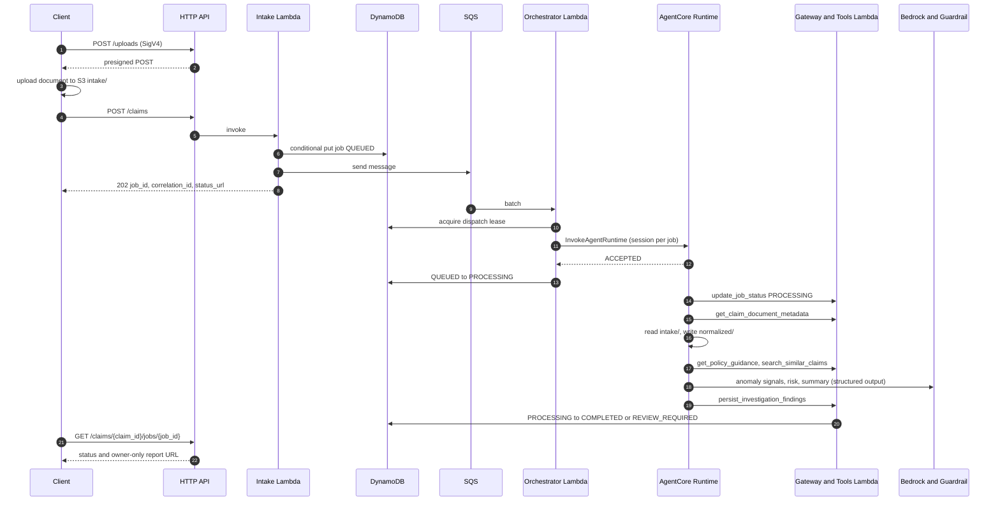
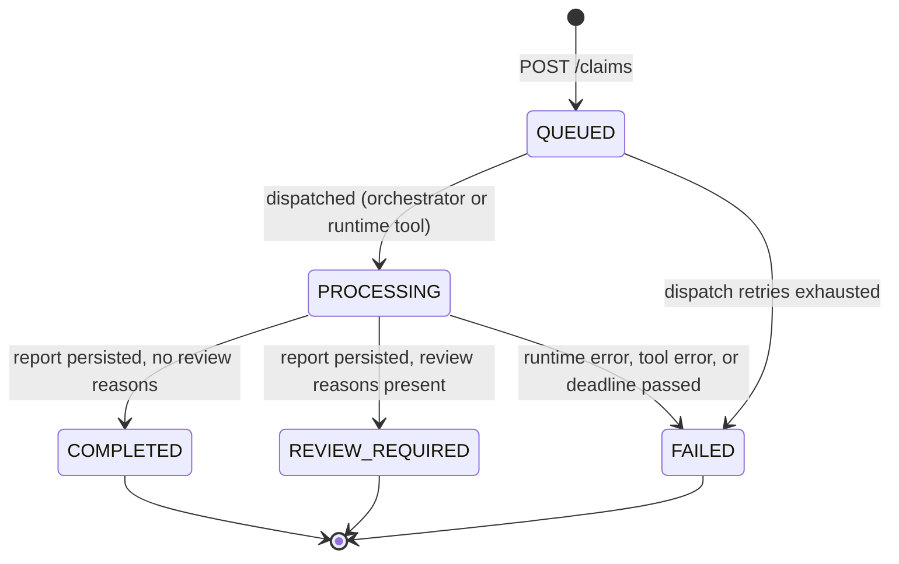

# Architecture

## Goals

- Turn a submitted claim and its text documents into a structured, evidence-referenced **advisory**
  investigation report without blocking the caller.
- Make every finding traceable to claim evidence or retrieved synthetic guidance.
- Route anything uncertain, incomplete, blocked, malformed, or anomalous to a human analyst.
- Keep claim content out of queues, job records, logs, and long-term memory.

## Non-goals

- Approving, rejecting, pricing, or paying claims; deciding eligibility or coverage.
- Labelling claimants as fraudulent, inferring protected attributes, or diagnosing medical conditions.
- Processing real personal data in non-production environments.
- OCR or parsing of binary documents (see [Limitations](README.md#limitations)).

## Components

| Component | Responsibility | Code / Terraform |
|---|---|---|
| HTTP API | IAM-authorized routes `POST /uploads`, `POST /claims`, `GET /claims/{claim_id}/jobs/{job_id}`; access logs; throttling | `modules/api-gateway` |
| Upload Lambda | Presigned S3 POST restricted to the allowlisted content type and size range | `handlers/upload.py`, `services/uploads.py` |
| Intake Lambda | Validate the submission, check each object, quarantine mismatches, idempotent job creation, enqueue | `handlers/intake.py`, `services/intake.py` |
| Status Lambda | Job lookup scoped to the claim, deadline-based timeout, owner-only report URL | `handlers/status.py`, `services/status.py` |
| Orchestrator Lambda | SQS consumer; lease, invoke runtime, mark `PROCESSING`; partial batch failures | `handlers/orchestrator.py`, `services/dispatch.py` |
| AgentCore Runtime | Hosts the agent container; acknowledges and runs the investigation as an async task | `runtime.py`, `agents/pipeline.py`, `modules/agentcore-runtime` |
| Agents | Evidence extraction, anomaly signals (rules + model), risk assessment, report assembly | `agents/*.py` |
| AgentCore Gateway | IAM-authorized MCP endpoint exposing five approved tools | `modules/agentcore-gateway`, `tools/tool_definitions.json` |
| Tools Lambda | Implements the tools with strict Pydantic validation and job scoping | `handlers/gateway_tools.py`, `tools/dispatcher.py` |
| AgentCore Memory | Investigator preferences and job-scoped summaries (codes and counts only) | `gateways/agentcore_memory.py`, `modules/agentcore-memory` |
| Bedrock + Guardrail | Structured model output; content, topic, PII, and prompt-attack filtering | `gateways/bedrock_model.py`, `modules/bedrock-guardrail` |
| OpenSearch Serverless | Vector + lexical retrieval over synthetic guidance and historical examples | `gateways/opensearch.py`, `modules/opensearch` |
| DynamoDB | Job status, idempotency, dispatch lease | `gateways/dynamodb.py`, `modules/dynamodb` |
| S3 | `intake/`, `normalized/`, `reports/`, `quarantine/`, `sample-data/` in one SSE-S3-encrypted bucket | `storage_keys.py`, `modules/s3` |
| Observability | JSON logs with correlation IDs, EMF metrics, alarms, dashboard | `logging.py`, `metrics.py`, `modules/observability` |

## Sequence

## Asynchronous state model

Transitions are enforced by `models/jobs.ALLOWED_TRANSITIONS` and DynamoDB condition expressions.
`COMPLETED` means "report ready with no review triggers", never "claim approved".

## Failure handling

| Failure | Behaviour |
|---|---|
| Invalid request | `400` with field locations only; no input echoed. |
| Object missing, oversized, or wrong type | `422`; mismatched objects moved to `quarantine/`. |
| Client retry | Same `client_request_id` and body returns the same job (re-enqueued while `QUEUED`); different body returns `409`. |
| Duplicate SQS delivery | Skipped unless the job is `QUEUED` and unleased. |
| Runtime invocation error | Lease released, record reported in `batchItemFailures`, SQS retries with backoff by visibility timeout. |
| Retries exhausted | Job marked `FAILED`/`DISPATCH_EXHAUSTED`; message moves to the DLQ; alarm fires. |
| Model blocked or invalid output | Step degrades to deterministic output, confidence capped at 0.3, review forced. |
| Tool error | Retried only for `DEPENDENCY_UNAVAILABLE`; otherwise job `FAILED`/`TOOL_ERROR`. |
| Deadline passed | Strands cancel signal set; job `FAILED`/`TIMEOUT`. If the runtime cannot write status, the status API marks the job `FAILED`/`TIMEOUT` after `processing_deadline`. |
| AWS throttling / 5xx | botocore standard retries with bounded attempts; then `DependencyUnavailableError` (`503` at the API). |

## Security controls

- IAM (SigV4) on every API route and on the Gateway (`AWS_IAM`); no anonymous endpoints.
- Separate roles per Lambda, runtime, and gateway. Learning configuration attaches account-wide
  `AdministratorAccess` to each workload role; do not use with real data or in production.
- AWS-managed/service-managed encryption where available for application and Terraform state resources;
  SNS alarm messages contain metrics/resource names only and are not encrypted.
- S3 public access blocked, versioning, lifecycle expiry; no custom bucket or queue deny policies.
- Presigned POST enforces content type and size; intake re-checks stored objects.
- The model has no tools; pipeline code makes all tool calls, so injected instructions cannot widen access.
- Claim and retrieved text is fenced as untrusted data; injection markers force review.
- Logs redact sensitive keys and never include exception messages or payloads.

Details: [docs/threat-model.md](docs/threat-model.md).

## Data classification

| Data | Classification | Where it lives |
|---|---|---|
| Uploaded documents, claim narrative | Confidential (synthetic in non-prod) | S3 `intake/`, `normalized/` |
| Normalized evidence, reports | Confidential | S3 `normalized/`, `reports/` |
| Job records | Internal (identifiers, status, keys, counts) | DynamoDB |
| Queue messages, runtime payload | Internal (identifiers and S3 keys only) | SQS, runtime invocation |
| Memory | Internal (hashed principal, codes, counts) | AgentCore Memory |
| Guidance and historical examples | Internal, synthetic | S3 `sample-data/`, OpenSearch |
| Logs and metrics | Internal (no claim content) | CloudWatch |

Retention: [docs/privacy-and-retention.md](docs/privacy-and-retention.md).

## Human-review boundary

`services/human_review.assess_review` alone decides whether a job needs review (ADR 0004). Review is
required when any of these hold: an anomaly signal; a `MEDIUM`/`HIGH` risk indicator; confidence below
`CLAIMS_REVIEW_CONFIDENCE_THRESHOLD`; missing information; inconsistent evidence; a guardrail
intervention; malformed model output; a dropped ungrounded finding; no guidance retrieved; or embedded
instructions detected in submitted content. The tools Lambda re-checks the reasons it can derive from the
persisted result and rejects a `COMPLETED` report that should require review. Every report carries a fixed
advisory notice.

## AgentCore interactions

- **Runtime**: `InvokeAgentRuntime` with `runtimeSessionId = claims-job-{job_id}`; the entrypoint validates
  `RuntimeInvocation`, registers an async task (ping reports `HealthyBusy`), and returns `ACCEPTED`.
- **Gateway**: MCP over HTTPS signed with SigV4 (`bedrock-agentcore`); tool names are
  `claims-tools___<tool>`; the Lambda target receives arguments as the event and returns
  `{ok, result | error}`.
- **Memory**: `actorId = sha256(principal ARN)`, `sessionId = claims-job-{job_id}`; strategies
  `/claims/preferences/{actorId}` and `/claims/summaries/{actorId}/{sessionId}`; failures degrade to empty context.
- **Guardrails**: applied through the Strands `BedrockModel` (`guardrail_id`, `guardrail_version`); stop
  reasons `guardrail_intervened` / `content_filtered` are treated as blocked.

## Evidence and grounding rules

- Evidence IDs: `meta:<field>` (submission), `doc:<document_id>` (whole document),
  `doc:<document_id>#L<n>` (line), `doc:<document_id>#key:<name>` (JSON key), `src:<chunk_id>` (retrieved chunk).
- Findings must cite only IDs present in the evidence index or retrieved sources; others are dropped and
  recorded as a limitation and review reason. `InvestigationResult` re-validates this on persist.
- Retrieval returns only what the index returned; an empty result stays empty.
- Deterministic rules (amount, incident date, policy reference, reported-before-incident, late
  reporting > 30 days, missing required documents) run regardless of model availability.
- Generated text is validated against prohibited wording (fraud labels, adjudication, eligibility, diagnosis).
