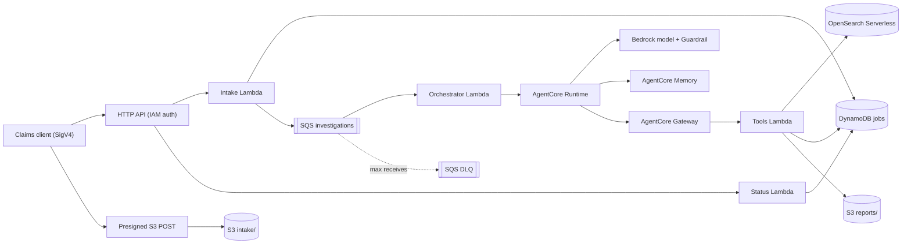

# Insurance Claims Investigation Agent

An asynchronous, **advisory-only** investigation assistant for insurance claims, built on Amazon Bedrock
AgentCore (Runtime, Gateway, Memory), Amazon Bedrock with Guardrails, Amazon OpenSearch Serverless,
Amazon S3, Amazon SQS, AWS Lambda, Amazon DynamoDB, and Amazon CloudWatch. Infrastructure is
Terraform; Python is managed with `uv`.

> **Responsible use.** This system organises evidence for a licensed claims analyst. It never approves,
> rejects, prices, or pays a claim, never decides eligibility, never labels anyone as fraudulent, never
> infers protected attributes, and never diagnoses medical conditions. All output is advisory, and
> uncertain, incomplete, blocked, or anomalous cases are routed to human review (`REVIEW_REQUIRED`).
> All sample data is synthetic; do not load real personal data into a non-production deployment.

## Product overview

### What it is

A back-office assistant that prepares an **investigation brief** for each submitted insurance claim. An
analyst (or an intake system) submits claim details and supporting documents; the assistant works in the
background and returns a structured, evidence-linked report that a human reviews. It does the time-consuming
groundwork of reading documents, cross-checking facts, and finding relevant guidance, so that people can
spend their time on judgement.

Every report contains:

- an **executive summary** of the claim as submitted;
- an **evidence list** in which every statement points to a document line or submitted field;
- **missing information** (for example a required repair estimate that was not provided);
- **potential anomaly signals** (for example amounts that differ between the form and an invoice, or a
  report filed long after the incident), each with confidence and limitations;
- **risk indicators** and **recommended analyst actions**, each linked to evidence;
- **retrieved guidance and similar historical examples** used as context;
- a clear routing outcome: `COMPLETED` (nothing notable found) or `REVIEW_REQUIRED` (with the reasons).

### Who benefits

| Audience | Benefit |
|---|---|
| Claims analysts and adjusters | Start each file with a consistent, evidence-linked brief instead of reading every document from scratch; see gaps and inconsistencies up front. |
| Special investigation and quality teams | Receive cases already flagged with explainable signals and the evidence behind them, rather than unexplained scores. |
| Claims operations managers | Predictable, asynchronous throughput; status tracking per job; a queue of cases that need human attention. |
| Compliance, audit, and risk | Advisory-only design, deterministic routing rules, citations for every finding, structured logs, and correlation IDs for each step. |
| Policyholders (indirectly) | Complete files are identified sooner, and missing documents can be requested earlier in the process. |
| Engineering and platform teams | A reference implementation of an agentic workflow on AWS with guardrails, IAM roles, staged Terraform, and tests. |

### Business use cases

1. **Intake triage.** Check completeness against the documents expected for the claim type and list what is
   missing before an analyst picks up the file.
2. **Consistency checks.** Compare amounts, dates, and policy references across the submission and its
   documents, and flag differences for review.
3. **Guidance at the point of work.** Retrieve the relevant internal procedure and similar past examples so
   analysts apply guidance consistently.
4. **Review routing.** Send uncertain, incomplete, or anomalous cases to human review using fixed,
   explainable rules, and let straightforward files move on.
5. **Workload balancing.** Run investigations asynchronously in the background so that intake peaks do not
   block analysts.
6. **Training and demonstration.** Use the synthetic scenarios (complete, missing documents, inconsistent)
   and the web app to show how evidence-based review works.

### How it fits a claims workflow

```text
Claim received ──> documents uploaded ──> investigation brief generated (in the background)
      ──> COMPLETED: analyst confirms and proceeds with normal handling
      ──> REVIEW_REQUIRED: analyst reviews the listed reasons, requests information, or escalates
                                    (all decisions stay with the analyst and existing claim systems)
```

Users interact through the signed HTTP API, the operator scripts, or the optional [web app](#6-web-app-on-s3-optional)
(see the [user guide](docs/user-guide.md)).

### What it is not

- Not a claims decision engine: no approval, rejection, pricing, payment, or eligibility decisions.
- Not a fraud-detection verdict: it reports *potential anomaly signals* that require human review and never
  labels a person as fraudulent.
- Not a system of record: it does not replace the policy administration or claims management system.
- Not suitable for real personal data as delivered: the dev setup, sample data, and web app are for
  synthetic data and demonstrations; a production rollout needs the hardening listed under
  [Limitations](#limitations) and [Future enhancements](#future-enhancements).

### Design principles

- **Human in control:** output is advisory; ambiguous or low-confidence results go to review.
- **Explainable:** every finding cites evidence; reports that cite unknown evidence are rejected.
- **Safe by construction:** the model has no tools of its own, Bedrock Guardrails filter input and output,
  and wording that implies a decision or a fraud label is rejected.
- **Role-based access:** each component assumes its own IAM role, deployed in a separate first stage. In
  this learning configuration, each workload role has `AdministratorAccess`; this is not suitable for
  production.
- **Asynchronous and resilient:** queue-based processing with idempotent submission, retries, and a
  dead-letter queue.

## Architecture summary

1. A client requests a presigned S3 POST (`POST /uploads`) and uploads text-based claim documents.
2. The client submits claim metadata (`POST /claims`). The intake Lambda validates it, checks every
   object, creates a job in DynamoDB idempotently, sends an SQS message, and returns `202 Accepted`.
3. The orchestrator Lambda (SQS trigger, partial batch failures) leases the job and starts an
   investigation in AgentCore Runtime, which acknowledges immediately and runs it as an async task.
4. The agent (Strands + Bedrock + Guardrails) extracts evidence, retrieves synthetic guidance and
   similar cases through AgentCore Gateway tools, detects potential anomaly signals, assesses risk,
   writes a structured JSON + Markdown report, and records `COMPLETED` or `REVIEW_REQUIRED`.
5. `GET /claims/{claim_id}/jobs/{job_id}` returns status and, for the submitting principal, a short-lived
   report URL.



More detail: [ARCHITECTURE.md](ARCHITECTURE.md), [docs/architecture-diagram.md](docs/architecture-diagram.md),
and the ADRs in [docs/adr](docs/adr).

## Repository structure

```text
.
├── src/claims_investigator/   Python package
│   ├── models/                Pydantic request, job, message, evidence, findings, result models
│   ├── services/              domain services + Protocol ports (no AWS SDK imports)
│   ├── gateways/              AWS SDK / Strands / MCP adapters implementing the ports
│   ├── agents/                evidence, anomaly-signal, risk, report agents and the pipeline
│   ├── handlers/              Lambda handlers (upload, intake, status, orchestrator, gateway_tools)
│   ├── tools/                 Gateway tool contracts (tool_definitions.json) and dispatcher
│   ├── prompts/               system prompts
│   └── runtime.py             AgentCore Runtime entrypoint
├── tests/                     unit, contract, integration (opt-in), fixtures
├── scripts/                   Python operator scripts (create_index, seed_sample_data, submit_sample_claim,
│                              check_job, destroy_environment)
│   └── sh/                    bash task scripts (build, test, terraform, deploy, cleanup)
├── sample-data/               synthetic claims, guidance, historical examples
├── web/                       static web app (HTML/CSS/ES modules, no build step) + node tests
├── docker/runtime.Dockerfile  AgentCore Runtime image (linux/arm64)
├── infra/                     Terraform: bootstrap, modules, environments/{dev,prod}/{foundation,platform,web}
└── docs/                      architecture, data flow, threat model, runbook, ADRs, ...
```

## Prerequisites

- `uv` (0.9 or later); Python 3.13 is selected via `.python-version`.
- Terraform `>= 1.11` (S3 native state locking); AWS provider `~> 6.66`.
- Docker with `buildx` for `linux/arm64` images; AWS CLI v2 for ECR login.
- An AWS account you control, credentials with rights to deploy the stack, and Amazon Bedrock access to
  your chosen text model (or inference profile) and to `amazon.titan-embed-text-v2:0` in the Region.

Supported workstations: Linux and macOS (Apple silicon or Intel). On macOS, install the tools with
Homebrew and Docker Desktop; the system `make` (GNU Make 3.81) and `/bin/bash` are sufficient:

```bash
xcode-select --install                     # provides make, git, and command-line tools
brew install uv awscli hashicorp/tap/terraform
# Install Docker Desktop for Mac (includes buildx); Apple silicon builds the arm64 image natively.
uv sync                                    # uv downloads Python 3.13 automatically
```

The scripts verify TLS with the `certifi` CA bundle, so no extra certificate setup is needed for the
uv-managed Python on macOS. `scripts/sh/build_lambda.sh` cross-installs Linux arm64 wheels on any host.

## AWS credentials (named profile)

Terraform, the S3 state backend, the Python scripts, the AWS CLI, and the ECR login all use the standard
AWS credential chain. Configure credentials once as an **AWS CLI named profile**; never put access keys in
`terraform.tfvars`, `backend.hcl`, `.env`, or any file in this repository (saved Terraform plans store
variable values in plaintext, and the scripts would not see keys stored there).

### Option A: access key and secret key

```bash
aws configure --profile claims-dev
# AWS Access Key ID [None]:     <your access key id>
# AWS Secret Access Key [None]: <your secret access key>
# Default region name [None]:   us-east-1
# Default output format [None]: json
```

The keys are written to `~/.aws/credentials` and the region to `~/.aws/config`, outside the repository.
Use an IAM user or role with only the permissions needed to deploy this stack, enable MFA, and deactivate
or rotate the keys when you are done.

### Option B: IAM Identity Center (SSO), no long-lived keys

```bash
aws configure sso --profile claims-dev     # follow the prompts (start URL, Region, account, role)
aws sso login --profile claims-dev         # repeat when the session expires
```

### Use the profile

```bash
aws sts get-caller-identity --profile claims-dev   # confirm the account and identity

# Either export it for the whole shell session...
export AWS_PROFILE=claims-dev
scripts/sh/whoami.sh

# ...or set it for a single command
PROFILE=claims-dev scripts/sh/tf_plan.sh dev foundation
```

Use one profile per account (for example `claims-dev` and `claims-prod`) so a command can never target
the wrong account by accident. Run `scripts/sh/whoami.sh` before every apply or destroy. Unit tests ignore
`AWS_PROFILE` and always use fake credentials.

For `indexer_principal_arns`, use the IAM ARN of the identity that runs the seeding scripts:

- IAM user: the `Arn` from `aws sts get-caller-identity`, for example `arn:aws:iam::111122223333:user/alex`.
- Assumed role or SSO: convert `arn:aws:sts::<account>:assumed-role/<RoleName>/<session>` to the role ARN
  `arn:aws:iam::<account>:role/<RoleName>` (SSO role names start with `AWSReservedSSO_`; include their
  path, which you can look up with `aws iam get-role --role-name <RoleName> --query Role.Arn`).

## Configuration

- **Python** reads only environment variables (prefix `CLAIMS_`, plus `AWS_REGION`). Every variable is
  listed in [.env.example](.env.example); Terraform sets them on each Lambda and on the runtime. The
  application never loads `.env` files.
- **Terraform**: each environment has two stacks, `foundation` (IAM roles) and `platform`
  (everything else). Shared values live in `infra/environments/<env>/common.tfvars` (copy
  `common.tfvars.example`; required `region`, `model_id`; optional `opensearch_vpc_endpoint`).
  Platform-only values live in `platform/terraform.tfvars` (copy `terraform.tfvars.example`; optional
  `indexer_principal_arns`, `alarm_email`, `agent_image_tag`). Environment-specific retention and
  protection settings live in `infra/environments/<env>/{foundation,platform}/locals.tf`.
- **Encryption:** the application data bucket and Terraform state bucket use SSE-S3 (AES256); ECR uses
  AES256 and SQS uses SQS-managed SSE. Other services use AWS-managed defaults where available. SNS
  alarm messages are not encrypted and contain metrics/resource names only, never claim data. A legacy
  customer-managed key remains in the bootstrap stack temporarily so historical state versions can
  still be read; it is not configured for new S3 writes.

## uv commands

```bash
uv sync                 # dev + agent dependency groups (default)
uv run pytest           # unit + contract tests
uv run ruff check src tests scripts
uv run mypy
```

## Task scripts

Every repeatable task is a bash script in `scripts/sh/` (bash 3.2+, Linux and macOS). Run any script with
`--help` to print its usage. Scripts marked `[AWS]` create, change, or read resources in your account.

| Script | Purpose |
|---|---|
| `sync.sh` | Install dependencies (`uv sync`) |
| `fmt.sh`, `lint.sh`, `typecheck.sh` | Format; ruff format check and lint; strict mypy |
| `test.sh [pytest args]` | Unit + contract tests with coverage (no AWS access) |
| `security.sh` | Bandit and detect-secrets |
| `check.sh` | lint, typecheck, test, security, and Terraform format check |
| `tf_fmt.sh`, `tf_validate.sh` | Terraform format check; validate all stacks (no backend, no AWS calls) |
| `build_lambda.sh` | Build `dist/lambda.zip` (arm64, Python 3.13) |
| `build_image.sh [tag]` | Build the runtime image (`linux/arm64`) |
| `whoami.sh` | [AWS] Show the account and identity in use |
| `tf_init.sh <env> <stack>`, `tf_plan.sh <env> <stack>`, `tf_apply.sh <env> <stack>` | [AWS] Initialise, plan, apply the saved plan; `<stack>` is `foundation` (IAM roles, apply first) or `platform` (plan checks foundation is applied and builds the Lambda zip) |
| `push_image.sh <env> <tag>` | [AWS] Push the image to the environment's ECR repository |
| `create_index.sh <env> [--recreate]`, `seed.sh <env>` | [AWS] Create the index; upload and index sample data |
| `submit_sample.sh <env> [scenario]`, `check_job.sh <env> <claim_id> <job_id>` | [AWS] Submit a synthetic claim; wait for its job |
| `test_integration.sh` | [AWS] End-to-end test against a deployed stack |
| `destroy.sh <env>` | [AWS] Guarded destroy (platform, web if initialised, then foundation) plus runtime log-group cleanup |
| `web_build.sh [env]`, `web_serve.sh [env] [port]` | Assemble the web app into `build/web` (with `<env>`, [AWS] reads `api_endpoint`); serve it on `127.0.0.1` |
| `web_deploy.sh <env>` | [AWS] Build the web app and sync it to the web stack's S3 website bucket |
| `clean.sh` | Remove local build artefacts and caches |
| `share_clean.sh [--yes \| --archive <file.tar.gz>]` | Before sharing: dry-run list, delete local config/secrets and generated files (`--yes`), or build a clean archive without deleting (`--archive`); never deletes Terraform state |

`<env>` is `dev` or `prod`. Set `PROFILE=<name>` (or `AWS_PROFILE`) to choose the AWS CLI profile.

## Deploying (Terraform)

All steps below create or change resources in your AWS account. Review every plan. They assume
`export AWS_PROFILE=claims-dev` (see [AWS credentials](#aws-credentials-named-profile)); alternatively prefix
each command with `PROFILE=claims-dev`.

### 1. Bootstrap remote state (once per account)

```bash
export AWS_PROFILE=claims-dev
cd infra/bootstrap
cp terraform.tfvars.example terraform.tfvars   # set region
terraform init
terraform apply
terraform output                               # state_bucket_name, region
```

The bootstrap stack uses local state; keep `infra/bootstrap/terraform.tfstate` safe (it contains no
secrets) or migrate it into the bucket afterwards.

New state objects use SSE-S3. Remove `kms_key_id` from any existing local `backend.hcl`; `tf_init.sh`
checks for it before reconfiguring the backend. Before applying the bootstrap change that removes the
legacy key, re-encrypt or let expire every historical state object version that uses it. Scheduling a
KMS key for deletion disables it immediately, making those versions unreadable.

### 2. Stage 1: foundation (IAM roles)

```bash
cd infra/environments/dev
cp backend.hcl.example backend.hcl                 # bucket and region from bootstrap outputs
cp common.tfvars.example common.tfvars             # set region, model_id, ...
cp platform/terraform.tfvars.example platform/terraform.tfvars   # indexer_principal_arns, ...
cd -
scripts/sh/whoami.sh                               # confirm the target account
scripts/sh/tf_init.sh dev foundation
scripts/sh/tf_plan.sh dev foundation
scripts/sh/tf_apply.sh dev foundation
```

Review the roles and policies (for example in the IAM console) before continuing. Foundation policies
reference ARNs derivable from names; permissions on resources with service-generated IDs (guardrail,
memory, gateway, OpenSearch collection, runtime) are attached by the platform stack.

For learning convenience, foundation attaches AWS-managed `AdministratorAccess` to every Lambda,
Runtime, and Gateway role. This is intentionally account-wide and unsafe for production or real claim data.

**Existing deployment warning:** older versions may have encrypted application data or state with
customer-managed keys. The current configuration uses AWS-managed/service-managed encryption and no
longer manages those keys. Back up or migrate any data you need, and re-encrypt or expire every old
object/state version that depends on those keys before allowing them to be disabled or deleted. The
existing dev stack from the former single-stack layout must be destroyed with its previous configuration
before using this staged layout; never destroy production as a shortcut.

### 3. Stage 2: platform (without the agent runtime)

```bash
scripts/sh/tf_init.sh dev platform
scripts/sh/tf_plan.sh dev platform                 # fails unless foundation is applied; builds dist/lambda.zip
scripts/sh/tf_apply.sh dev platform
```

With `agent_image_tag = null` the runtime is not created and the SQS trigger is disabled, so submitted
jobs wait in the queue.

### 4. Build and push the runtime image, then apply platform again

```bash
scripts/sh/build_image.sh v1
scripts/sh/push_image.sh dev v1
# set agent_image_tag = "v1" in infra/environments/dev/platform/terraform.tfvars
scripts/sh/tf_plan.sh dev platform && scripts/sh/tf_apply.sh dev platform
```

### 5. Allow callers to use the API

Routes use IAM authorization. Grant analysts or test roles `execute-api:Invoke`, for example:

```json
{
  "Version": "2012-10-17",
  "Statement": [{
    "Effect": "Allow",
    "Action": "execute-api:Invoke",
    "Resource": "<api_execution_arn output>/*/*"
  }]
}
```

### 6. Web app on S3 (optional)

A dependency-free static web app in [web/](web/) lets an analyst connect, submit a claim (or load a
synthetic sample scenario), upload documents, follow the job, and read the advisory report. Step-by-step
usage: [docs/user-guide.md](docs/user-guide.md).

```bash
scripts/sh/tf_init.sh dev web && scripts/sh/tf_plan.sh dev web && scripts/sh/tf_apply.sh dev web
scripts/sh/tf_plan.sh dev platform && scripts/sh/tf_apply.sh dev platform   # API + upload-bucket CORS
scripts/sh/web_deploy.sh dev
```

Dev defaults to `web_allowed_origins = ["*"]` (any origin; every API call is still SigV4-signed and every
S3 call presigned, so CORS is not the access control). To narrow it, set it to the web stack output
`website_url` in `platform/terraform.tfvars`. Prod defaults to `[]` (CORS off).

`tf_plan.sh <env> web` first reads the account-level S3 Block Public Access setting (read-only) and stops if
it blocks public bucket policies. Changing it is an account-wide decision for the account owner, e.g.
`aws s3control put-public-access-block --account-id <id> --public-access-block-configuration
BlockPublicAcls=true,IgnorePublicAcls=true,BlockPublicPolicy=false,RestrictPublicBuckets=false`
(this keeps ACLs blocked everywhere; every other bucket here keeps its own bucket-level block).

Sign in by pasting temporary credentials from
`aws configure export-credentials --profile <name> --format process` (use a role that only has
`execute-api:Invoke` on the API). Credentials stay in the tab's memory; they are never stored or uploaded.
Only identifiers of recent jobs are kept in the browser's local storage.

Security trade-offs of this hosting choice (user-selected for demos): the S3 website endpoint is
**HTTP only** and the bucket is **public-read**; a network attacker could alter the page and capture
pasted credentials. Use short-lived, narrowly scoped credentials on trusted networks only, or put
CloudFront with HTTPS in front before wider use. The account-level S3 Block Public Access setting must
allow public bucket policies, otherwise the web stack apply fails. Report links are presigned and only
issued to the identity that submitted the claim.

Local preview: `scripts/sh/web_serve.sh dev` serves on `http://127.0.0.1:8000` (allowed by `"*"`).

## Sample data

Synthetic scenarios are described in [sample-data/README.md](sample-data/README.md). The principal running
these commands must be listed in `indexer_principal_arns`.

```bash
scripts/sh/create_index.sh dev
scripts/sh/seed.sh dev       # uploads sample-data/ to S3 and indexes guidance + historical examples
```

Newly indexed documents can take up to about a minute to become searchable.

## Submitting a synthetic claim and checking status

```bash
scripts/sh/submit_sample.sh dev inconsistent
# prints job_id, claim_id, correlation_id, status_url
scripts/sh/check_job.sh dev CLM-SYN-TRVL-1A2B3C <job_id>
scripts/sh/check_job.sh dev CLM-SYN-TRVL-1A2B3C <job_id> --download-report report.json
```

Request body for `POST /claims` (see `ClaimSubmission` in `src/claims_investigator/models/api.py`):

```json
{
  "client_request_id": "0b9a6c1e-2f3d-4e5f-8a7b-9c0d1e2f3a4b",
  "claim_id": "CLM-SYN-AUTO-1A2B3C",
  "policy_reference": "POL-SYN-2001",
  "claim_type": "AUTO",
  "incident_date": "2026-08-14",
  "reported_date": "2026-08-16",
  "claimed_amount": "2480.00",
  "currency": "USD",
  "incident_description": "SYNTHETIC: low-speed car park collision.",
  "documents": [
    {
      "document_id": "<from POST /uploads>",
      "object_key": "intake/CLM-SYN-AUTO-1A2B3C/<document_id>/claim_form.txt",
      "document_type": "CLAIM_FORM",
      "content_type": "text/plain"
    }
  ]
}
```

Retrying with the same `client_request_id` and body returns the same job; reusing it with a different
body returns `409`.

## Testing, linting, and security checks

```bash
scripts/sh/test.sh                          # pytest with coverage (unit + contract; no AWS access)
scripts/sh/lint.sh && scripts/sh/typecheck.sh   # ruff + mypy (strict)
scripts/sh/security.sh                      # bandit + detect-secrets
scripts/sh/tf_fmt.sh && scripts/sh/tf_validate.sh   # no backend, no AWS calls
scripts/sh/check.sh                         # all of the above except tf_validate
```

Unit tests replace only AWS and model boundaries; a fixture forces fake credentials so tests cannot
reach an account. The end-to-end test (`scripts/sh/test_integration.sh`) runs only against a deployed
stack with `CLAIMS_IT_API_ENDPOINT` set. See [docs/testing-strategy.md](docs/testing-strategy.md).

## Troubleshooting

| Symptom | Likely cause and action |
|---|---|
| `Unable to locate credentials`, `ExpiredToken`, or wrong account | Set `AWS_PROFILE` (or prefix `PROFILE=<name>`), run `aws sso login --profile <name>` for SSO, and check with `scripts/sh/whoami.sh`. |
| `terraform plan`: no file `dist/lambda.zip` | Run `scripts/sh/build_lambda.sh` (or plan with `scripts/sh/tf_plan.sh`, which builds it). |
| `Permission denied` running a script | Run `chmod +x scripts/sh/*.sh` (or invoke it as `bash scripts/sh/<name>.sh`). |
| `model_id` validation error | Replace the `REPLACE_...` placeholder with a model or inference profile ID enabled in your account. |
| API returns `403` | Request not SigV4-signed (service `execute-api`) or caller lacks `execute-api:Invoke`. |
| `422 DOCUMENT_REJECTED` | Object missing, too large, or stored content type differs; rejected objects are moved to `quarantine/`. |
| Jobs stay `QUEUED` | Runtime not deployed yet (`agent_image_tag` null disables the SQS trigger) or orchestrator errors; check its logs. |
| `FAILED` / `DISPATCH_EXHAUSTED` | Runtime invocation failed repeatedly; message is in the DLQ. See the [runbook](docs/operations-runbook.md). |
| `FAILED` / `TIMEOUT` | Investigation exceeded its deadline or the runtime could not reach the Gateway; check runtime logs by `correlation_id`. |
| Every job `REVIEW_REQUIRED` with `NO_GUIDANCE_RETRIEVED` | Index not created or seeded, indexing delay, or tools role missing from the data-access policy. |

## Cleanup

```bash
scripts/sh/build_lambda.sh   # the configuration is evaluated during destroy
scripts/sh/destroy.sh dev    # plan -destroy, type the env name to apply, delete runtime log groups
scripts/sh/clean.sh          # local build artefacts
```

`scripts/destroy_environment.py` refuses to run unless `--confirm` matches the environment, refuses `prod`
without `--allow-prod`, shows the destroy plan, and asks for the environment name again before applying it.
After Terraform finishes it deletes the AgentCore Runtime log groups (`/aws/bedrock-agentcore/runtimes/...`)
for that environment's runtime, which the service creates outside Terraform.

`dev` allows destroying a non-empty bucket and ECR repository. `prod` enables DynamoDB deletion protection
and keeps data on destroy: disable protection and empty the bucket deliberately before destroying. The
bootstrap state bucket has `prevent_destroy`; remove it manually only after every environment is gone.

## Limitations

- Extraction supports `text/plain`, `text/csv`, and `application/json` only (no PDF parsing or OCR);
  other formats are recorded as missing information for the analyst.
- Report access is limited to the submitting IAM principal; there is no analyst workflow, case
  assignment, or decision-recording API.
- AgentCore Memory preferences are read but not written by this version (no preference-capture API);
  session summaries contain only codes and counts.
- Bedrock Guardrails contextual grounding is not used; grounding is enforced in application code.
- Runtime job de-duplication is in-process; cross-instance duplicates are prevented by the DynamoDB lease.
- Some behaviours can be verified only after deployment (Gateway MCP response shape, runtime image
  platform, index mapping on the collection generation); see `AGENTS.md` §5.
- Single Region; no disaster-recovery automation.

## Future enhancements

- Document text extraction for PDFs and images (for example with Amazon Textract), with quarantine scanning.
- Analyst console with case assignment and decision recording kept outside the agent's authority.
- Evaluation harness with labelled synthetic cases and regression thresholds for prompts and models.
- Private networking end to end (VPC runtime, VPC endpoints for Bedrock, S3, DynamoDB, and SQS).
- Cross-Region replication of reports and point-in-time recovery drills.

## License

[MIT](LICENSE).
