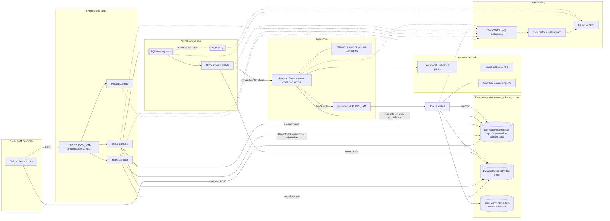

# Architecture diagrams

## System diagram with security and observability

## Synchronous versus asynchronous boundaries

- **Synchronous** (bounded by API timeouts): upload presigning, submission validation, job creation,
  enqueue, and status reads. These do no model or retrieval work.
- **Asynchronous**: everything after the SQS message. The orchestrator only dispatches; the investigation
  runs inside AgentCore Runtime as a tracked async task bounded by `CLAIMS_INVESTIGATION_TIMEOUT_SECONDS`.

## Trust boundaries

1. **Caller -> API**: authenticated by SigV4 and authorized by `execute-api:Invoke`; inputs validated by Pydantic.
2. **Uploaded content -> system**: documents are untrusted; size and type enforced by the S3 POST policy
   and re-checked at intake; text is fenced as untrusted data in prompts.
3. **Runtime -> tools**: SigV4 to the Gateway; tool arguments re-validated and scoped to the job's claim,
   correlation ID, and status.
4. **Model -> system**: output must parse into Pydantic models, pass prohibited-wording checks, and cite
   known evidence; the model cannot call tools.
5. **Retrieved content -> prompts**: synthetic guidance is still treated as untrusted data.

## Data flow

See [data-flow.md](data-flow.md) for the step-by-step flow and what each store holds.

## Retry and DLQ behaviour

- SQS redelivers a failed record after the visibility timeout (6x the orchestrator timeout).
- The orchestrator reports only failed records (`ReportBatchItemFailures`).
- On the final receive (`ApproximateReceiveCount >= maxReceiveCount`) the job is marked `FAILED` /
  `DISPATCH_EXHAUSTED` before SQS moves the message to the DLQ; the DLQ-depth alarm fires.
- Tool calls retry only `DEPENDENCY_UNAVAILABLE` (bounded, exponential backoff); AWS SDK clients use
  botocore standard retry mode with bounded attempts.

## Human-review boundary

Deterministic routing in `services/human_review.py` decides `REVIEW_REQUIRED`; the tools Lambda re-checks
it on persist. The system has no permission or tool that could approve, reject, or pay a claim.

## Encryption and identity controls

- AWS-managed/service-managed encryption where available for application resources; SNS alarms carry
  metrics/resource names only. The Terraform state bucket uses SSE-S3.
- Service calls use HTTPS. The learning setup has no explicit bucket or queue deny policy for insecure
  transport.
- Separate IAM roles: upload, intake, status, orchestrator, tools, runtime, gateway; each scoped to the
  resources and S3 prefixes it needs.

## Observability and correlation IDs

- A correlation ID is accepted from `x-correlation-id` (validated) or generated at the API, stored on the
  job, carried in the SQS message, the runtime payload, every tool call, and every log line.
- Logs are JSON with `correlation_id`, `job_id`, `claim_id`, and event names; sensitive keys are redacted.
- EMF metrics (namespace `ClaimsInvestigator`, dimension `Environment`): `ClaimsAccepted`,
  `JobsCompleted`, `JobsReviewRequired`, `JobsFailed`, `JobDuration`, `DispatchFailed`,
  `ModelStepDegraded`, `ToolLatency`, `ToolErrors`, `UngroundedFindingsDropped`.
- Alarms: oldest-message age, DLQ depth, Lambda errors and throttles, jobs failed.
